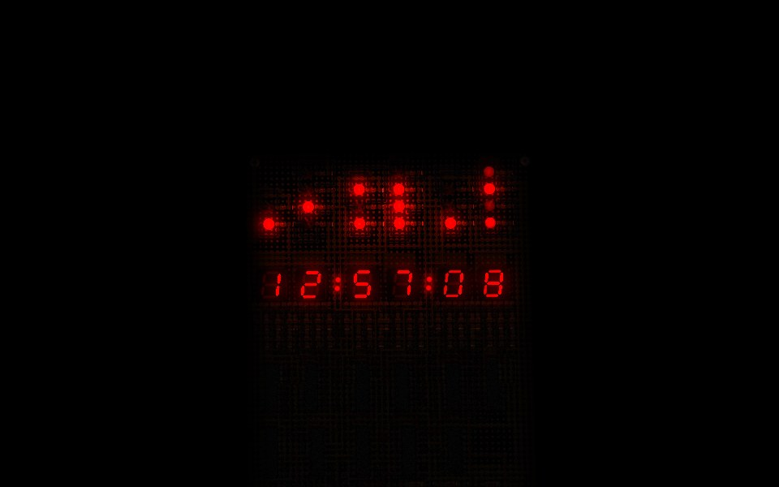

# Perfboard clock — Windows screen saver + html




**Download:** grab `PerfboardSaver.scr` from the [Releases](../../releases) page and
right-click it → **Install**; Windows makes it the active saver. Set the wait time in
**Settings → Personalisation → Lock screen → Screen saver**. Nothing else to install.

> The build is not code-signed, so Windows SmartScreen may warn the first time —
> choose **More info → Run anyway**. The saver NEVER opens a network connection
> and the whole thing builds from the source in this repo.

Two things you can run, plus the stills used on this page:

| File | What it is |
| `index.html` | the live scene (WebGL2, self-contained, 1.1 MB) — opens in any browser |
| `release/PerfboardSaver.scr` | Windows screen saver — **one file, 1.9 MB**, nothing to install but the file itself: clock on one monitor, pure black on the others, with scale + position settings |
| `lazy_install.ps1` | optional: copies the `.scr` into `%LOCALAPPDATA%\ScreenSavers\Perfboard` and makes it the active saver, without admin rights |

---

## Why this exists

I ran the same binary-clock screensaver for years — Adam Lyttle's *AL Binary Clock Screensaver*,
freeware from 2005. But it could be opened only on one monitor.

Then came the stranger question. A screensaver is a clock — but what would
the thing look like in the real world? So the board in the picture is drawn to be buildable — real parts, real pin counts, every
wire on the top face where you could actually solder it.

---

### Install

There is **one file to install**: `release\PerfboardSaver.scr`. 

**Route 1 — no terminal (recommended).**

1. Copy `release\PerfboardSaver.scr` somewhere permanent, e.g. `Documents\Screen savers\` or System32.
   Windows will point at that exact path, so don't leave it in the downloads folder or inside
   the unzipped repo — if you move or delete it later, the screen saver stops working.
2. Right-click the `.scr` → **Install**.
3. Settings → Personalisation → Lock screen → **Screen saver** to set the wait time. 

**Route 2 — the script.**

```powershell
powershell -ExecutionPolicy Bypass -File .\lazy_install.ps1
```

It copies the `.scr` to `%LOCALAPPDATA%\ScreenSavers\Perfboard\`, points
`HKCU\Control Panel\Desktop\SCRNSAVE.EXE` at that copy and switches screen saving on.
Per-user, so no admin prompt, and nothing goes into `C:\Windows`. `-NoActivate` copies the file
without changing the saver you have now.


#### What it writes, and how to remove it

| registry | one value, `HKCU\Control Panel\Desktop\SCRNSAVE.EXE` — the same one Windows' own dialog writes |
| files | the `.scr` itself, plus `%LOCALAPPDATA%\PerfboardSaver\` (`config.json` + the extracted `scene.html`, created on first run) |
| nothing else | no service, no startup entry, no scheduled task, no `C:\Windows`, no elevation |

To uninstall: Settings → Screen saver → **None**, then delete the `.scr` and
`%LOCALAPPDATA%\PerfboardSaver\`. DONE.

If it does nothing at all, run `check.ps1` — it reads the registry, the installed files, the two
runtimes and any quarantine, and prints the fix.

### Three monitors

The saver creates one borderless black window per display and hands the *clock*
display to a WebView2 instance. Every other display is filled with `#000000`.

Which display counts as "the clock" is a setting:

* **Middle monitor (auto)** — default. The display that contains the centre of the
  virtual desktop, i.e. the middle one on a 1‑2‑3 arrangement.
* **Primary**, **Left-most**, **Right-most**, or an explicit
  `Monitor <centreX> (<w> × <h>)` entry from the list.

### Scale and position

In **Settings → Screen Saver → Settings**, or directly:

```powershell
& "$env:LOCALAPPDATA\ScreenSavers\Perfboard\PerfboardSaver.scr" /c
```

* **Scale** — 15 % … 600 %. 100 % fits the board to the screen height.
* **Move horizontally / vertically** — ±50 % of the screen. Only meaningful with
  the board scaled past the point where it would leave the display.
* **Reset** puts it back to fit-and-centre.

While the saver is actually running you can tune it live and see the result on the
wall: **`+` / `−`** scale, **arrow keys** move, **`R`** resets. Each step is written
to the config immediately, so the next start keeps it. Any *other* key, a mouse
click or moving the mouse quits — standard saver behaviour.

Config lives in `%LOCALAPPDATA%\PerfboardSaver\config.json`:

```json
{
  "Monitor": "middle",
  "Zoom": 0.4,
  "OffsetX": 0.0,
  "OffsetY": 0.0
}
```

### Requirements

* Windows 10 1903+ or Windows 11, x64.
* **Microsoft Edge WebView2 Runtime** — likewise preinstalled on Windows 11 and
  on any machine that has Edge; if it is somehow missing the saver shows a
  one-line prompt with the link instead of failing silently.

### Offline

The clock never opens a network connection, and it does not merely *avoid*
making requests — WebView2 is a browser engine, so it is told not to:

* `--disable-background-networking`, `--disable-component-update`,
  `--disable-domain-reliability`, `--no-pings` — no update or telemetry traffic;
* `--host-resolver-rules="MAP * ~NOTFOUND"` — DNS is dead, so no hostname can
  resolve even if something tried;
* a `WebResourceRequested` filter that answers **403 to everything except
  `file:`, `data:` and `blob:`**.

The scene itself contains no external URL of any kind — the four texture maps
are inlined as base64 data URIs — so in a normal start not one request leaves
the process. The same is true of the build: `release\PerfboardSaver.scr` has
the scene, both WebView2 assemblies and the native loader embedded, and nothing
is unpacked to disk except two cached files under `%LOCALAPPDATA%`.
* The scene is rendered on the GPU. On a laptop on battery Windows may cap the
  frame rate; the scene is capped at 60 fps and repaints only when the clock
  changes, so it idles cheaply.

### Rebuild

```powershell
.\build.ps1                 # 1.9 MB single file, .NET Framework 4.8 (in-box)
.\build.ps1 -Net8           # 2.2 MB folder, needs the .NET 8 Desktop Runtime
.\build.ps1 -SelfContained  # ~66 MB single file, self-extracting (not recommended)
```

The default build targets **.NET Framework 4.8**, which ships inside Windows, so
the output is one `.scr` with no runtime to bundle and no folder to keep
together. `index.html` is embedded as the `scene.html` resource at build time, so rebuild the
scene first (`python3 build.py`) if you changed anything under `src/` or `assets/`.

### Regenerating the artwork

`assets/perfboard_topview.svg` is the whole illustration: a flat top-down drawing of the board with
every LED off, and the six display windows already drawn as flat dark glass. The four maps are
rasterised from it in three steps that must run in order:

```bash
npm install          # once: pulls @resvg/resvg-js, the SVG rasteriser
npm run textures     # build_assets.py -> shrink_assets.py -> build.py
python3 serve.py     # then http://localhost:8000/ to look at the result
```

| step | what it does |
| `build_assets.py` | rasterises four passes from the same element list so they line up pixel for pixel: albedo (everything off), height in mm/10, material (roughness / specular / metalness), contact AO. Also emits `geometry.json` — LED centres and their BCD bit weights, the 42 segment polygons, the colon LEDs |
| `shrink_assets.py` | downsamples and re-encodes for shipping — every KB here costs 1.33 KB in `index.html` |
| `build.py` | inlines the maps + geometry + JS into `index.html` |


#### If you redraw the SVG

Traces, holes, resistors, silkscreen, colours: all free. The maps follow, and resistors never light
up, so moving them cannot upset the clock — only the paint changes.

The emitters are read back out of the drawing **by shape**, so they are the part to be careful with:

| what | found as |
| an LED | a circle of radius 25.85 |
| a colon dot | a circle of radius 12.65 |
| a digit bar | one of the 42 filled polygons inside the six windows (filled with the glass colour `#120d0d` on purpose — keep it, that is what keeps the window flat) |

Change those radii and the shape stops being recognised. 

`npm run shot` re-takes `docs/on-screen.jpg`; it is the only thing here that needs Playwright, so
`npm install --omit=dev` is enough if all you want is the artwork pipeline.

---

### Look variants

`?segStyle=` picks how a bar is drawn — `classic` (generated 7-segment: chamfered
ends, corner gaps, hard edges, leaned 7.5°, this is the default), `art` (the
illustration's own segment polygons) or `tube` (rounded capsule strokes).

`?mood=` picks the lighting — `chosen` (default: emission forced to the red
channel only, spill with the vertical profile below), `pure` (red, no spill),
`bounce` (red, even spill), `warm` (white-hot cores, full spill, the original look)
or `now`.

`?panel=` adds the module: `1` draws all seven bars as dark red plastic even when
off (like a real module seen in the light), `2` also rims each black window so the
module rectangle reads against the board.

`?digits=` scales the display itself (1.0 default, 1.08 is noticeably bigger), and
`?zoom=` / `?ox=` / `?oy=` frame the camera. The contact sheets that were used to
choose the digits, the lighting and the framing have been deleted — the look is
settled, and they were only ever working papers.


---

## Files

```
perfboard-saver/
├── index.html                 built scene (do not edit — generated)
├── build.py                   inlines assets + src into index.html
├── serve.py                   local preview, http://localhost:8000/ (no stale cache)
├── package.json               the two dev scripts: npm run textures, npm run shot
├── lazy_install.ps1           optional installer / activator (no admin)
├── docs/                      how-it-works.md + screenshots
├── CONTRIBUTING.md            how to try, what is welcome, ground rules
├── LICENSE                    MIT
├── assets/                    perfboard_topview.svg + the four maps + geometry.json
├── src/                       app.js + index.html template
├── tools/
│   ├── build_assets.py        SVG illustration -> the four maps + geometry.json
│   ├── shrink_assets.py       re-encodes the maps for shipping
│   ├── resvg.js               SVG rasteriser used by build_assets.py
│   └── shot_scene.js          headless screenshot of the scene
├── host/PerfboardSaver/       the host source (C#, WebView2) - shared by both builds
├── host/PerfboardSaver.Net48/ the single-file build (.NET Framework 4.8)
├── build.ps1                  local build
├── check.ps1                  read-only diagnostic: why did nothing happen?
└── release/PerfboardSaver.scr the built screen saver, 1.9 MB, one file
```

`index.html` accepts `?t=HH:MM:SS` (freeze the clock for stills) and
`?zoom=&ox=&oy=` (initial framing), and exposes `window.setView(zoom, ox, oy)` for
live control — that is the whole API the screen saver uses.

---

## Credits

- **The idea — *AL Binary Clock Screensaver* by Adam Lyttle** (freeware, 2005, Visual Basic 6).
  **No code, assets or configuration were taken from it.** The original is a 32-bit VB6
  program drawing three horizontal binary rows; this is C# hosting a WebGL2 scene, and every line of
  the shader, the illustration and the host was written for this project. The original is not
  redistributed here — it is the author's.
- **Microsoft Edge WebView2** — the renderer that hosts the scene. The three DLLs embedded in the
  `.scr` are the unmodified official builds from NuGet `Microsoft.Web.WebView2` 1.0.2592.51,
  redistributed under Microsoft's WebView2 SDK licence.
- **The board** — the perfboard illustration is drawn to be a buildable design, that design work is a separate, unfinished project and is not part of this repository.

## Licence

MIT — see [LICENSE](LICENSE).

---

Made by [Covelight](https://github.com/Covelight) · Covelight's Workshop
